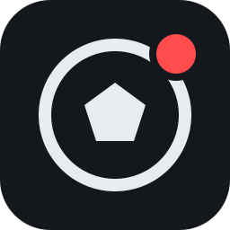

<div align="center">



# Record2Discord

Chaque but d'EA Sports FC, clippé et posté sur Discord. Sans y penser.

[Fonctionnement](#fonctionnement) · [Installation](#installation) · [Configuration](#configuration) · [Réglages](#réglages) · [Développement](#développement)

</div>

<br />

Record2Discord est une application Windows qui regarde ton match, repère les buts sur le bandeau du score et envoie le clip dans le salon Discord de ton choix. Elle vit dans la zone de notification et ne demande plus rien une fois réglée.

Tout tourne sur ta machine. Les seules sorties réseau sont l'envoi du clip à Discord et, une fois par jour, une vérification de la dernière version publiée sur GitHub. Quand une version plus récente existe, un bandeau le signale dans la fenêtre : rien n'est téléchargé ni installé tout seul.

## Fonctionnement

1. OBS garde en mémoire la dernière minute de jeu.
2. Record2Discord lit le score deux fois par seconde.
3. Quand le score augmente, le replay est sauvegardé, réduit sous la limite de taille de Discord, puis publié.
4. Le message indique l'équipe qui a marqué et le score.

Un raccourci clavier permet aussi d'envoyer les dernières secondes à la demande, pour une action qui n'est pas un but.

## Prérequis

| | |
|---|---|
| Système | Windows 10 ou 11 |
| Capture | [OBS Studio](https://obsproject.com/fr) 28 ou plus récent |
| Carte graphique | NVIDIA (l'encodage des clips utilise NVENC) |
| Discord | Un salon dont tu peux gérer les webhooks |

## Installation

1. Lance `Record2Discord-Setup-x.y.z.exe`.
2. L'installeur n'est pas signé : si Windows affiche un avertissement, choisis **Informations complémentaires**, puis **Exécuter quand même**.
3. Suis la configuration ci-dessous.

## Configuration

### OBS

À faire une seule fois. Le même guide est disponible dans l'application, onglet **Guide OBS**.

**1. Capturer le jeu**

- Panneau **Sources** : **+**, puis **Capture de jeu**.
- Mode **Capturer une fenêtre spécifique**, puis choisis le jeu (il doit être lancé).
- Si l'aperçu reste noir en match, utilise une source **Capture d'écran**.

**2. Régler la vidéo**

- **Paramètres > Vidéo** : résolution de base et de sortie égales à celle de ton écran.
- Ne réduis pas la résolution de sortie : le score doit rester net pour être lu.

**3. Régler l'enregistrement**

- **Paramètres > Sortie** : **Mode de sortie** sur **Avancé**.
- Onglet **Enregistrement** : format MP4 ou MKV, encodeur **NVIDIA NVENC H.264**.
- Contrôle du débit : **CBR à 20 000 Kbps**.

**4. Activer le tampon de relecture**

- **Paramètres > Sortie**, onglet **Tampon de relecture**.
- Coche **Activer le tampon de relecture**, durée maximale **60 s**, mémoire maximale **1024 Mo**.
- Inutile de le démarrer à la main : l'application s'en charge.

**5. Activer le serveur WebSocket**

- **Outils > Paramètres du serveur WebSocket** : coche **Activer le serveur WebSocket**.
- Garde le port **4455** et l'authentification activée.
- **Afficher les informations de connexion**, copie le mot de passe, puis **Appliquer**.

### Application

1. Dans Discord : **Paramètres du salon > Intégrations > Webhooks > Nouveau webhook > Copier l'URL**.
2. Dans l'onglet **Réglages**, colle l'URL du webhook et le mot de passe WebSocket d'OBS. Les réglages s'enregistrent tout seuls.
3. Clique sur **Envoyer un message de test** pour vérifier le salon.
4. Lance un match : dans l'onglet **État**, les voyants OBS, Bandeau du score et Discord doivent être verts.

Fermer la fenêtre laisse l'application tourner près de l'horloge. Pour la quitter : clic droit sur son icône, puis **Quitter**.

## Réglages

| Réglage | Rôle |
|---|---|
| Message | Texte posté avec le clip (voir les champs ci-dessous). |
| Durée du clip | Longueur du clip envoyé. Plus il est court, meilleure est l'image. |
| Secondes gardées après le but | Temps de célébration conservé à la fin du clip. |
| Résolution | 720p ou 1080p. |
| Taille maximale | 10 Mo par défaut, 50 ou 100 Mo si le serveur Discord est boosté. |
| Supprimer les fichiers locaux | Efface le replay et le clip une fois l'envoi réussi. |
| Raccourci clavier | Envoie les dernières secondes à la demande, même en jeu. F1 à F24 seules, ou Ctrl, Alt, Maj avec une autre touche. |
| Équipes à enregistrer | Limite l'envoi aux buts de certaines équipes (onglet **Calibration**). |
| Lancer OBS automatiquement | Ouvre OBS réduit s'il n'est pas déjà lancé. |
| Démarrer avec Windows | Lance l'application réduite à l'ouverture de session. |

### Champs du message

| Champ | Remplacé par |
|---|---|
| `{scorer}` | Équipe qui a marqué |
| `{homeTeam}` | Équipe à domicile, en haut du bandeau |
| `{awayTeam}` | Équipe à l'extérieur, en bas du bandeau |
| `{home}` | Score à domicile |
| `{away}` | Score à l'extérieur |

Par exemple, `⚽ But de {scorer} : {homeTeam} {home} - {away} {awayTeam}` donne « ⚽ But de ACH : ACH 1 - 0 CFC ». Les noms sont les abréviations lues sur le bandeau.

### Équipes à enregistrer

Saisis les initiales telles qu'affichées sur le bandeau, séparées par une virgule (par exemple `ACH, CFC`). Champ vide : tous les buts sont envoyés. Si le nom d'une équipe est illisible, le but est envoyé quand même.

## Calibration

Il n'y a rien à faire par défaut : les zones du score sont préréglées pour le bandeau d'EA Sports FC 27 sur un écran 16:9.

Pour vérifier, ouvre l'onglet **Calibration** pendant un match. Le bloc **Ce que lit l'application** affiche en direct l'image de chaque zone, le chiffre reconnu et le nom de l'équipe. Si le jeu se met en pause quand tu le quittes, la dernière lecture faite en match reste affichée.

Si le bandeau a changé de place (mise à jour du jeu, autre taille de HUD, écran ultra-large), lance une capture, reviens en match, puis entoure chaque chiffre à la souris sur l'image.

## Limites connues

- Le score est fiable de 0 à 9. Au-delà, il est compté à partir du dernier score lu.
- Un but marqué pendant le lancement de l'application, ou pendant qu'un réglage s'enregistre, n'est pas détecté.
- Les noms d'équipes sont lus par reconnaissance de texte : une erreur reste possible, et `?` s'affiche quand un nom est illisible.
- Le webhook doit être une adresse Discord (`https://discord.com/api/webhooks/...`).

## Développement

```bash
pnpm install
pnpm dev     # lance l'application
pnpm test    # lance les tests
pnpm dist    # construit l'installeur dans dist/
```

| Dossier | Contenu |
|---|---|
| `src/core` | Réglages, configuration, journal |
| `src/features` | Détection, enregistrement, clip, publication, surveillance |
| `src/electron` | Processus principal |
| `src/renderer` | Interface React |

Les journaux et les réglages sont stockés dans `%APPDATA%\Record2Discord`. Le webhook et le mot de passe d'OBS y sont chiffrés.

## Composants tiers

L'installeur embarque [FFmpeg](https://ffmpeg.org), distribué sous licence GPL (binaire fourni par le paquet `ffmpeg-static`), et le moteur de reconnaissance de texte [Tesseract](https://github.com/tesseract-ocr/tesseract) (licence Apache 2.0) avec son modèle anglais.

Record2Discord n'est affilié ni à Electronic Arts, ni à Discord, ni au projet OBS.

<br />

<div align="center">

© 2026 AlexherApps

</div>
